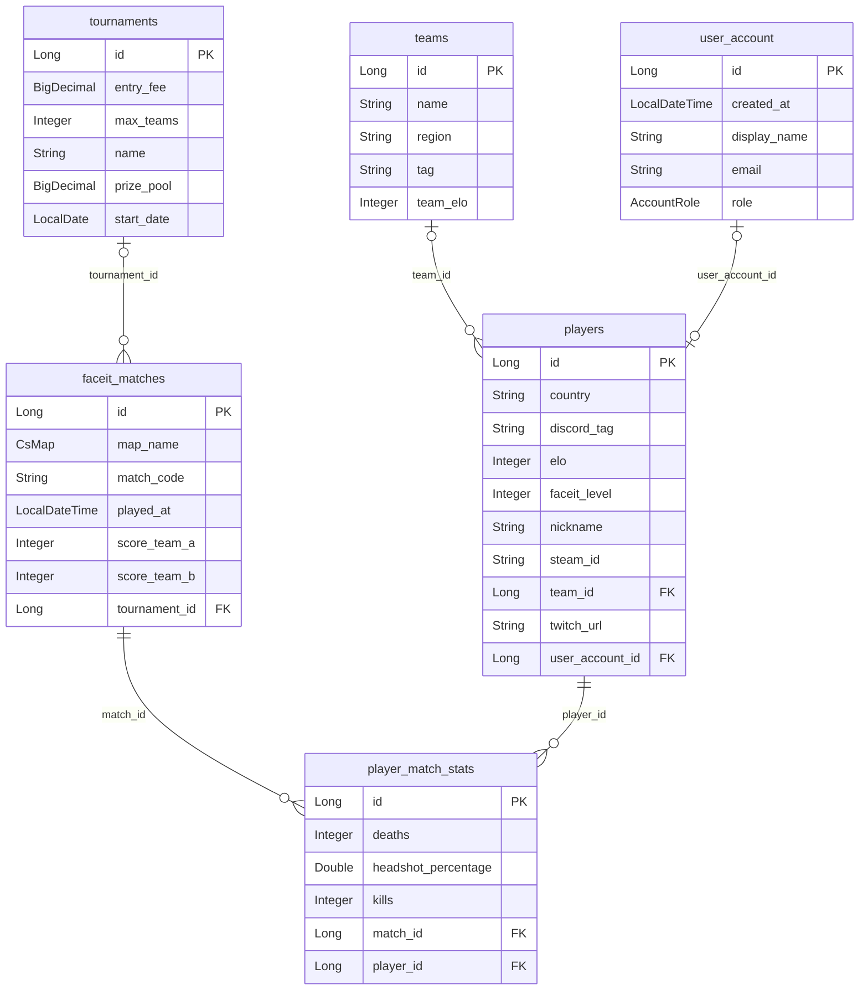

# Schemat bazy danych

Plik generują reguły projektu (panel Maven → Lifecycle → verify). Nie edytujcie go ręcznie.

Tabele: 6 · kolumny: 39 · relacje: 4 × @ManyToOne, 1 × @OneToMany, 1 × @OneToOne, 0 × @ManyToMany

| Tabela | Encja | Kolumny | Klucze obce |
|---|---|---|---|
| faceit_matches | FaceitMatch | 7 | tournament_id |
| player_match_stats | PlayerMatchStat | 6 | match_id, player_id |
| players | Player | 10 | team_id, user_account_id |
| teams | Team | 5 | — |
| tournaments | Tournament | 6 | — |
| user_account | UserAccount | 5 | — |

